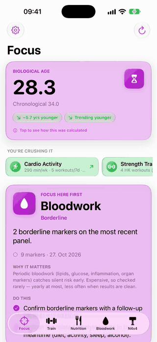
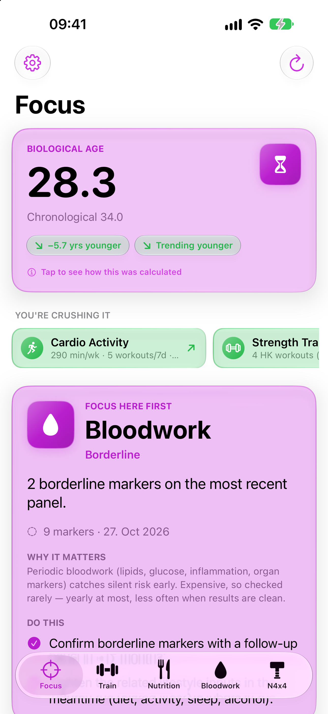
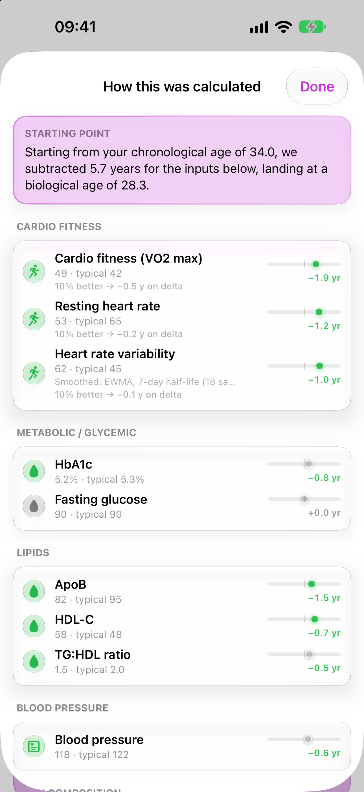
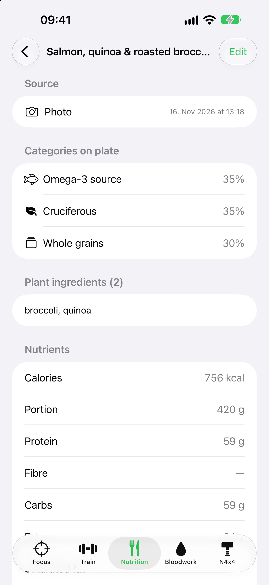
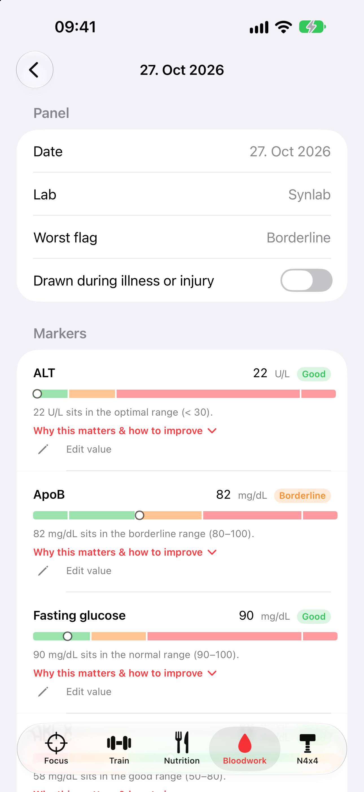

# Longevity Compass

**A multi-sensor biological-age estimator for iOS — 24 HealthKit, bloodwork and behaviour signals fused into a transparent, hand-reproducible 10-factor model, plus a hybrid local/cloud AI pipeline for nutrition capture.**

[](https://github.com/fabian-kir/longevity-compass/actions/workflows/ci.yml)


<!-- DEMO GIF — see docs/media/CAPTURE.md for how to record this -->
<p align="center">
  
</p>

---

## What it is

Longevity Compass turns the signals an iPhone and Apple Watch already collect into a single, explainable number: **how old your physiology looks versus your actual age**, and the *one thing* most worth doing about it today.

Unlike a black-box "health score", every year the engine adds or subtracts is traceable to a single reading times a single weight. The methodology is documented in full and **reproducible by hand with a calculator** — see [`docs/biological-age-methodology.md`](docs/biological-age-methodology.md).

This is a solo-built portfolio project. It runs entirely on-device: no backend, no accounts, no telemetry.

---

## Screens

| Focus | Bio-age breakdown | Nutrition capture |
|:---:|:---:|:---:|
|  |  |  |
| Today's top lever, with rationale and one-tap actions | Per-factor z-score contributions + linearised sensitivity readout | Camera-first logging via on-device Vision + cloud vision model |

| Trends | Bloodwork |
|:---:|:---:|
|  |  |
| 7/28/90-day mini-charts across all tracked signals | Manual panel entry (ApoB, HbA1c, hs-CRP…) with reference ranges |

---

## The engineering (why this is a cybernetics project, not "an iOS app")

The core is `BiologicalAgeEngine` — a multi-input estimator that fuses noisy, irregularly-sampled sensors into a single state estimate under explicit, documented assumptions.

**Transparent additive model.** 24 signals are grouped into 10 factors; each factor is a freshness-and-quality-weighted mean of signed "years impact" terms, clamped at a per-factor cap so no single noisy sensor can dominate:

```
biologicalAge = max(0, chronologicalAge + Σ_factor clamp(weightedMean_factor, ±yearsCap_factor))

rawYearsImpact   = −zScore × yearsPerSD          (z-scored against age/sex norms)
effectiveWeight  = freshnessWeight × qualityWeight
```

**Noise handling — continuous-time EWMA on HRV.** HealthKit's HRV (SDNN) is single-night noisy. Rather than the textbook fixed-grid `s_t = α·x_t + (1−α)·s_{t-1}`, the engine uses a **density-aware, continuous-time exponential smoother** with a 7-day half-life that weights each raw sample by its actual time gap (`e^(−Δt/τ)`) before z-scoring. This keeps the smoother honest when samples are irregular — exactly the kind of detail a controls/estimation reader looks for. ([methodology §5](docs/biological-age-methodology.md))

**Linearised sensitivity readout.** Because the signal-to-delta map is piecewise-linear, the app exposes a local slope: *"10% better HRV → −0.4 y on your delta."* This is a textbook linearised-sensitivity output (`∂delta/∂signal`, computed by finite difference) surfaced as a user-friendly number — and it correctly reads zero when a factor is saturated at its cap or suppressed. ([methodology §6](docs/biological-age-methodology.md))

**Cross-signal reasoning.** Three layers handle redundancy between correlated signals: downstream markers suppress the upstream behaviours they already capture (so you don't double-count), while upstream drivers and the single top lever are surfaced in the UI without touching the number.

---

## Hybrid AI nutrition pipeline

Meal logging is camera-first and routes intelligently between local and cloud:

- **Barcode** → on-device `Vision` detection → OpenFoodFacts lookup (no network round-trip for recognition).
- **Photo** → OpenRouter (Claude Sonnet 4.6 vision) extracts a **category fingerprint** — plate fractions, plant ingredients, macros per 100 g, typical serving size. The model is deliberately *never* asked to estimate absolute grams, avoiding false precision.
- **Offline** → an `NWPathMonitor`-backed queue holds captures and uploads them when connectivity returns.

API keys are stored in the **Keychain**; per-call cost is tracked and shown in Settings.

---

## Architecture

```
Views/        SwiftUI screens, one folder per tab + shared Components/
Models/       SwiftData @Model types + value types (snapshots, fingerprints)
Services/     Engines + integrations (HealthKit, OpenRouter, OpenFoodFacts, Keychain, …)
Config/       Tunable thresholds and norms
```

Key engines (all pure, testable Swift):

| Engine | Responsibility |
|---|---|
| `BiologicalAgeEngine` | 24 signals → 10 factors → years-of-age delta |
| `PriorityEngine` | impact × friction × status × trend across 12 domains |
| `TrackingRecommendationEngine` | what to surface on the Track tab, and when |
| `NotificationManager` | quiet-hours-aware, status-driven reminders |

Persistence is **SwiftData** with lightweight migration; export is JSON via dedicated DTOs.

---

## Tech stack

`SwiftUI` · `SwiftData` · `HealthKit` · `Vision` · `Swift Charts` · `Network` (NWPathMonitor) · `Keychain` · OpenRouter (Claude Sonnet 4.6 vision) · OpenFoodFacts · Gemini 2.5 Flash Image (custom exercise icons)

---

## Tests & CI

- An **XCTest** target (`Longevity CompassTests`) validates the engine against four synthetic profiles — elite endurance, metabolic syndrome (±bloodwork), and a vegan low-exercise case — asserting each lands in its expected bio-age band.
- **GitHub Actions** runs `xcodebuild test` on every push and PR to `main` (see [`.github/workflows/ci.yml`](.github/workflows/ci.yml)).

---

## Build & run

```bash
git clone <repo-url>
cd "Longevity Compass"
open "Longevity Compass.xcodeproj"
```

Requires Xcode targeting **iOS 26**. Build and run the `Longevity Compass` scheme on a simulator or device. Health data populates from HealthKit; the AI nutrition features need an OpenRouter API key (added in-app under Settings → it's stored in the Keychain).

---

## Scope

A deliberately bounded v1 — full feature inventory in [`docs/scope.md`](docs/scope.md). Explicit non-goals: no backend, no accounts, no Watch app, no multi-platform port. The depth is in the estimator, not the surface area.

---

*Built by Fabian Kirschenmann — B.Sc. Engineering Cybernetics. The bio-age engine is the part to read: [`docs/biological-age-methodology.md`](docs/biological-age-methodology.md).*
